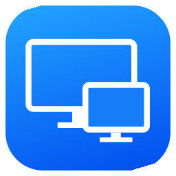
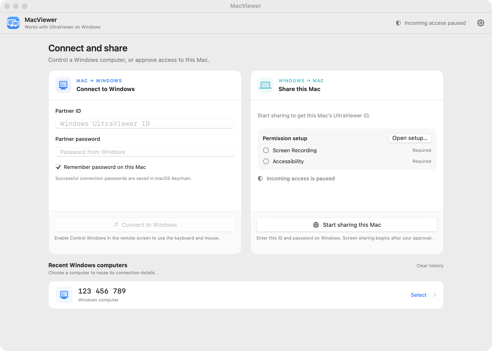

<div align="center">



# MacViewer

**A native macOS client for UltraViewer: control another computer from your Mac, or share your Mac.**

[Tiếng Việt](README.md) · **English**

### [Download MacViewer for macOS](https://github.com/DeanOpen/MacViewer/releases/latest)

Latest version, macOS 12 or later · [LinuxViewer for Linux](#linux-linuxviewer-experimental)

[](https://github.com/DeanOpen/MacViewer/actions/workflows/ci.yml)
[](https://github.com/DeanOpen/MacViewer/releases/latest)
[](LICENSE)




</div>

---

MacViewer connects to other computers running [**UltraViewer**](https://ultraviewer.net) (or MacViewer)
and accepts approved connections from them. It's built with SwiftUI and AppKit on
top of a Swift/C protocol engine. It doesn't use Wine, and it doesn't run any
Windows executable code.

> [!IMPORTANT]
> MacViewer is an independent, community-built implementation. It's **not**
> an official UltraViewer product and isn't affiliated with or endorsed by the
> UltraViewer developers. Only connect to computers you're authorized to access.

## Features

### Connect (control another computer)

- Connect with the partner **ID and password** shown in UltraViewer on the other computer
- Encrypted partner lookup and login, TLS relay with certificate validation,
  and a **direct LAN connection** that falls back to the relay when needed
- Fast screen decoding (Zstandard dictionary, RGB555/JPEG, scroll/copy, tile cache)
- Keyboard and mouse control that you turn on yourself:
  <kbd>⌘</kbd> → Win, <kbd>⌥</kbd> → Alt, <kbd>⌃</kbd> → Ctrl,
  with trackpad and wheel scrolling
- **Vietnamese and Chinese typing** while controlling: use a macOS input
  method (Telex/VNI, EVKey, Pinyin…). For Vietnamese you can also turn it off
  and use Unikey on the remote PC
- Toolbar with monitor selection, scaling, quality, wallpaper, remote cursor
  and **remote computer audio**
- Screenshots with region selection and annotations, and **video recording**
- Floating **chat** panel and opt-in two-way **clipboard** sharing
- **Send and receive files** in chat: click 📎 or drop files on the chat, and
  click **Save** on an incoming file. The save folder is chosen once and can be
  changed in Settings
- Optional password storage in the macOS **Keychain**
- **Nicknames** for recent computers (kept on this Mac only)

### Share (share this Mac)

- Share the Mac's screen with another UltraViewer user, after you approve
  each connection on the Mac
- Choose one Mac display or **All displays** before or during a connection.
  When sharing all displays, the Windows UltraViewer monitor menu can show
  one display at a time or the entire desktop
- A built-in guide for granting **Screen Recording** and **Accessibility**
  permissions
- You approve viewing or control separately. You can end a session or pause
  incoming access at any time.
- Copy the Mac's password or **make a new one**; the ID stays the same
- Set a fixed **master password** in Settings, optionally accepted without
  asking
- Set this Mac's **display name** in Settings (unaccented letters, up to 20)
- Send and receive files from the incoming session's chat, with the same
  save, progress and cancel controls as an outgoing session

### General

- English and Tiếng Việt UI, or follow the system language
- Universal binary (Apple silicon + Intel), macOS 12 Monterey or later

### Not supported yet

Microphone/voice chat, Mac-host audio, and unattended Mac access. Mac screen sharing does not send 2x
Retina images. Older Windows UltraViewer versions, non-US keyboard layouts, input methods other than
Vietnamese and Chinese, and 8-bit screen mode haven't been validated.

## Installation

With [Homebrew](https://brew.sh):

```sh
brew install --cask deanopen/tap/macviewer
```

Or install manually:

1. Open the [**Download**](https://github.com/DeanOpen/MacViewer/releases/latest) page and get `MacViewer-<version>.dmg`.
2. Open the DMG and drag **MacViewer** into **Applications**.
3. If the release isn't notarized, macOS will block the first launch. Right-click
   the app, choose **Open**, then confirm. You can also run:

   ```sh
   xattr -dr com.apple.quarantine /Applications/MacViewer.app
   ```

MacViewer shows an **Update to …** button in its title bar when a new version
is out. Click it, read what's new, then click **Update and Restart**: the app
downloads the update, checks its signature, installs it and reopens. You can
also choose **MacViewer → Check for Updates…** from the menu bar.

## Usage

**Connect to another computer:** Type the partner's **ID** and **password**
shown in UltraViewer, then click **Connect to another computer**. To send
keyboard and mouse input, turn on **Control** in the session toolbar.

**Share this Mac:** Click **Start sharing this Mac** and follow the permission
guide:

| Permission | Required for |
| --- | --- |
| Screen Recording | Letting the other computer see your screen |
| Accessibility | Letting the other computer control the keyboard and mouse |

Enter the Mac's ID and password on the other computer, then approve the request
on the Mac. If macOS asks, reopen MacViewer after you change Screen Recording.

Use **Share display** in the Mac's sharing card to choose a display or **All
displays**. With all displays shared, use UltraViewer's monitor menu on Windows
to switch between individual displays and the combined desktop. Display choice
is remembered on this Mac; if a selected display is disconnected, sharing stops
instead of switching to a different display.

The shared image is size-limited to save bandwidth: about 2 million pixels when
sharing one display (roughly 1920 × 1080) and about 8 million pixels when
sharing multiple displays (roughly 3840 × 2160), preserving each display's
aspect ratio and position. Retina displays are sent at their logical resolution
rather than 2x, so a session does not use twice the bandwidth.

Chat and file transfer work in both session roles. Incoming files are written
only after **Save** and never overwrite an existing file. UltraViewer's native
host file-name field uses the Windows ANSI code page without declaring it;
MacViewer uses an ASCII fallback for non-ASCII names when hosting, and a UTF-8
or Windows-1252 interpretation when receiving that legacy field. File contents
are transferred as binary data.

## Use with AI agents (MCP)

MacViewer includes an MCP server, so AI apps and coding agents can see the
remote screen and use the mouse and keyboard during a session you opened.

1. Open **MacViewer › Settings › AI Agents** and turn on **Allow AI agents to use MacViewer**.
2. Under **AI apps and coding agents**, click **Add** next to your app, or
   **Add to all detected apps**. Then restart that app.
3. Connect to a computer and switch **Control** on. Then ask the agent, for example:
   *"Take a screenshot of the remote computer and open Notepad."*

One-click setup supports Claude Code, Claude Desktop, Cursor, VS Code (GitHub
Copilot), VS Code Insiders, Windsurf, Codex, Gemini CLI, Zed, Cline, Roo Code,
Kiro, Amazon Q Developer, opencode, LM Studio and Continue. For Goose,
JetBrains AI Assistant and Warp, MacViewer copies a snippet you paste into that
app's settings. For any other app, use **Copy config**. The server runs
`MacViewer.app/Contents/MacOS/macviewer-mcp` (stdio), for example:

```sh
claude mcp add --scope user macviewer -- /Applications/MacViewer.app/Contents/MacOS/macviewer-mcp
```

Tools: `session_status`, `screenshot`, `click`, `move_mouse`, `drag`, `scroll`,
`type_text`, `press_keys`, `select_monitor`, `remote_action`, `send_chat`,
`read_chat`, `set_clipboard`, `get_clipboard`, `connect`, `disconnect`.

- AI agents are off by default. Everything stays on this Mac: the helper talks to
  the app over a local socket that only your user account can open.
- Agents can use the mouse and keyboard only while **Control** is on. Starting or
  ending connections needs its own permission.
- Agents can see the screen, read chat and read the clipboard only while screen
  viewing is allowed; writing the clipboard also needs **Control**. **Stop** blocks
  every agent action except reading the session status until the session ends.
- MacViewer asks before a new agent acts. While an agent is controlling the
  computer, the session window shows **AI is controlling · Stop**.
- Before changing an app's config file, MacViewer saves a `.macviewer-backup`
  copy. It never rewrites files that contain comments.

## Building from source

Requirements: macOS 12+ to run (building needs macOS 14+), Xcode 16+ / Swift 6+.

```sh
git clone https://github.com/DeanOpen/MacViewer.git
cd MacViewer

swift test                       # run the test suite
scripts/package_app.sh release   # build dist/MacViewer.app
open dist/MacViewer.app
```

## Linux (LinuxViewer, experimental)

[`LinuxViewer/`](LinuxViewer/) is a Rust port for Linux. It connects to and
controls UltraViewer machines, and it can share an X11 or Wayland desktop. See
[LinuxViewer/README.md](LinuxViewer/README.md).

**Install (Debian, Ubuntu, Linux Mint — x86_64):**

```sh
curl -L -o linuxviewer.deb https://github.com/DeanOpen/MacViewer/releases/latest/download/linuxviewer-amd64.deb
sudo apt install ./linuxviewer.deb
linuxviewer                       # open the connect window
```

This download is lean: it needs only the C runtime and ALSA, so it installs on
any distro with one command. It includes everything except **Wayland hosting**
(viewing, control, X11 hosting, audio, chat and files all work). To host your
own screen from a Wayland session, use the Wayland build, which also needs
PipeWire:

```sh
curl -L -o linuxviewer.deb https://github.com/DeanOpen/MacViewer/releases/latest/download/linuxviewer-wayland-amd64.deb
sudo apt install ./linuxviewer.deb
```

**Or the portable tarball** (any distro, no install):

```sh
curl -L https://github.com/DeanOpen/MacViewer/releases/latest/download/linuxviewer-x86_64.tar.gz | sudo tar -xz -C /
linuxviewer
```

**Command line:**

```sh
linuxviewer connect 123456789   # view and control a machine
linuxviewer host                # share this Linux desktop
```

**Build from source** (needs Rust and `libxkbcommon-dev libasound2-dev libpipewire-0.3-dev libclang-dev`):

```sh
cd LinuxViewer
cargo build --release
./target/release/linuxviewer
```

## Project layout

```
Sources/
  MacViewer/              SwiftUI/AppKit app (UI, capture, input, hosting)
  UltraViewerProtocol/    Protocol engine: crypto, relay, screen codec, audio
ThirdParty/
  zstd/                   Zstandard 1.5.7 (BSD / GPLv2)
  g722/                   WebRTC G.722 decoder
Tests/                    Protocol and app unit tests
LinuxViewer/              Rust port for Linux (viewer + X11 hosting)
scripts/                  App packaging, icon and DMG generation
```

## Contributing

Issues and pull requests are welcome. Before you open a PR, please:

1. Run `swift test` and make sure it passes.
2. Keep new user-facing strings in both `en.lproj` and `vi.lproj`.
3. Never commit credentials, partner IDs, session tokens or UltraViewer binaries.

## Privacy

MacViewer doesn't collect telemetry. The update check only reads public
release information from GitHub, and you can turn it off in Settings. Passwords are saved only when you choose
to remember them, and only in the macOS Keychain. They're never written to
recent-partner history, UserDefaults or registration profiles.

## License

MacViewer is released under the [MIT License](LICENSE).

Bundled third-party components keep their own licenses. See
[THIRD_PARTY_NOTICES.md](THIRD_PARTY_NOTICES.md). The `8bit.dat` screen
dictionary is an UltraViewer-supplied data asset and is **not** covered by the
MIT license.

UltraViewer is a trademark of its respective owner and is used here only to
describe compatibility.
