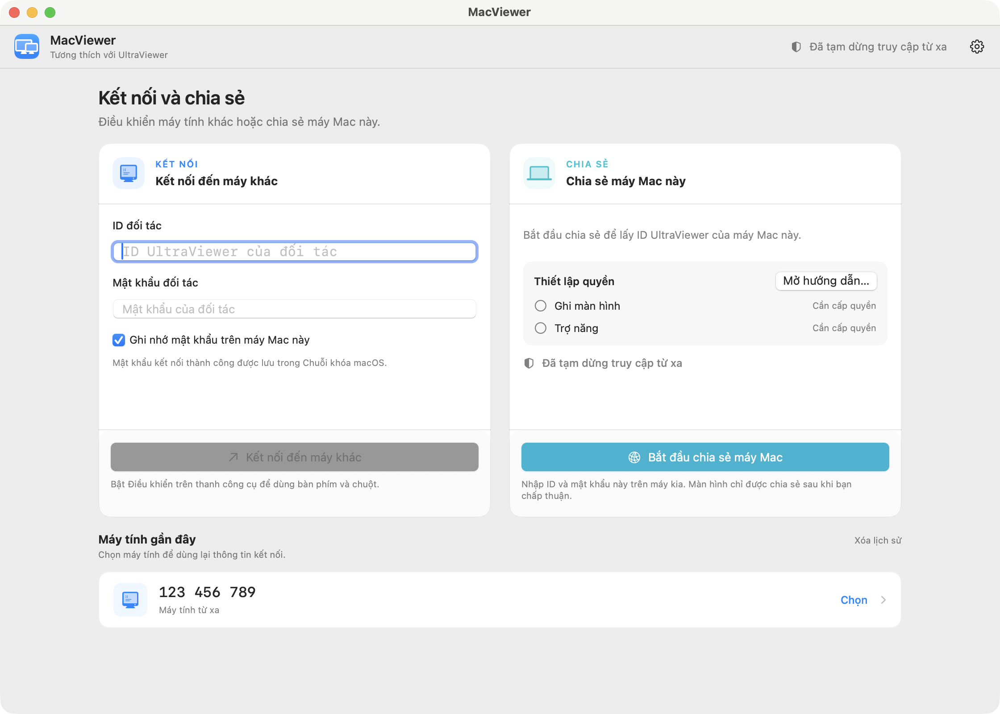

<div align="center">


# MacViewer

**Dùng UltraViewer ngay trên máy Mac: điều khiển máy khác hoặc cho người khác truy cập máy Mac của bạn.**

**Tiếng Việt** · [English](README.en.md)

### [Tải về MacViewer cho macOS](https://github.com/DeanOpen/MacViewer/releases/latest)

Bản mới nhất, macOS 12 trở lên · [LinuxViewer cho Linux](#linux-linuxviewer-thử-nghiệm)

[](https://github.com/DeanOpen/MacViewer/actions/workflows/ci.yml)
[](https://github.com/DeanOpen/MacViewer/releases/latest)
[](LICENSE)




</div>

---

[UltraViewer](https://ultraviewer.net/vi/) chỉ có bản cho Windows. MacViewer là ứng dụng macOS thuần, giúp
bạn kết nối tới máy đang chạy UltraViewer (hoặc MacViewer), và cho phép người
khác điều khiển máy Mac của bạn khi bạn đồng ý. Ứng dụng viết bằng
SwiftUI/AppKit, không cần Wine và không chạy bất kỳ file `.exe` nào của Windows.

> [!IMPORTANT]
> MacViewer là dự án cá nhân, mã nguồn mở, **không phải** sản phẩm chính thức
> của UltraViewer và không liên quan gì đến đội ngũ phát triển UltraViewer.
> Chỉ kết nối tới những máy mà bạn được phép truy cập.

## Tính năng

### Kết nối tới máy khác

- Nhập **ID và mật khẩu** hiện trên UltraViewer của máy kia là kết nối được
- Kết nối được mã hóa, đi qua máy chủ trung gian có TLS; nếu hai máy cùng mạng
  LAN thì tự kết nối trực tiếp cho nhanh
- Hiển thị màn hình mượt, hỗ trợ cả màn hình 4K
- Điều khiển chuột, bàn phím (chỉ khi bạn bật **Điều khiển**). Phím được chuyển
  đổi sẵn: <kbd>⌘</kbd> → Win, <kbd>⌥</kbd> → Alt, <kbd>⌃</kbd> → Ctrl. Cuộn
  bằng trackpad hay chuột đều được
- **Gõ tiếng Việt, tiếng Trung** khi điều khiển: dùng bộ gõ của macOS
  (Telex/VNI, EVKey, Pinyin…). Với tiếng Việt cũng có thể tắt bộ gõ trên Mac và
  dùng Unikey ở máy kia
- Thanh công cụ: chọn màn hình, thu phóng, chất lượng hình, ẩn/hiện hình nền,
  con trỏ chuột và **nghe âm thanh từ máy kia**
- Chụp màn hình (chọn vùng, ghi chú lên ảnh) và **quay video**
- **Chat** với người bên kia và đồng bộ **clipboard** hai chiều (tùy chọn)
- **Gửi và nhận file** ngay trong chat: bấm 📎 hoặc kéo thả file vào khung chat,
  bấm **Lưu** khi có file đến. Thư mục lưu được chọn một lần và đổi trong Cài đặt
- Có thể lưu mật khẩu vào **Keychain** của macOS cho lần sau
- **Đặt tên** cho các máy trong danh sách gần đây (chỉ lưu trên máy Mac)

### Cho người khác truy cập máy Mac

- Người khác chỉ xem hoặc điều khiển được sau khi bạn bấm đồng ý trên máy Mac
- Chọn một màn hình Mac hoặc **Tất cả màn hình** trước và trong khi kết nối.
  Khi chia sẻ tất cả, người dùng Windows có thể chọn xem từng màn hình hoặc
  toàn bộ màn hình qua menu màn hình của UltraViewer
- Có hướng dẫn từng bước để bật quyền **Ghi màn hình** và **Trợ năng**
- Quyền xem và quyền điều khiển được duyệt riêng. Bạn có thể ngắt kết nối hoặc
  tạm khóa truy cập bất cứ lúc nào
- Sao chép hoặc **tạo mật khẩu mới** cho máy Mac; ID giữ nguyên
- Đặt **mật khẩu chủ** cố định trong Cài đặt, có thể cho phép kết nối bằng mật khẩu này
  mà không cần bấm đồng ý
- Đặt **tên hiển thị** cho máy Mac trong Cài đặt (chữ không dấu, tối đa 20 ký tự)
- Gửi và nhận file trong chat của phiên truy cập vào Mac, có nút lưu, hủy và
  tiến trình truyền như khi Mac điều khiển máy khác

### Khác

- Giao diện tiếng Việt và tiếng Anh, hoặc tự theo ngôn ngữ của máy
- Chạy trên cả chip Apple (M1, M2…) và Intel, yêu cầu macOS 12 Monterey trở lên

### Chưa hỗ trợ

Nói chuyện qua micro, phát âm thanh khi chia sẻ máy Mac và truy cập không cần người ngồi máy. Khi
chia sẻ máy Mac, ảnh chưa được gửi ở độ phân giải Retina 2x. Chưa thử nghiệm với các bản UltraViewer
cũ, bàn phím không phải kiểu US, bộ gõ ngoài tiếng Việt và tiếng Trung, và chế độ màu 8-bit.

## Cài đặt

Cài bằng [Homebrew](https://brew.sh):

```sh
brew install --cask deanopen/tap/macviewer
```

Hoặc cài thủ công:

1. Vào trang [**Tải về**](https://github.com/DeanOpen/MacViewer/releases/latest) và tải file `MacViewer-<phiên bản>.dmg`.
2. Mở file DMG, kéo **MacViewer** thả vào thư mục **Applications**.
3. Mở MacViewer từ Launchpad hoặc thư mục Applications.

Khi có bản mới, MacViewer hiện nút **Cập nhật lên …** trên thanh tiêu đề. Bấm
vào, xem có gì mới, rồi bấm **Cập nhật và khởi động lại**: ứng dụng tự tải về,
kiểm tra chữ ký, cài đặt và mở lại. Bạn cũng có thể chọn **MacViewer → Kiểm tra
bản cập nhật…** trên thanh menu.

Nếu macOS báo không mở được ứng dụng, hãy nhấp chuột phải vào MacViewer, chọn
**Open** rồi bấm **Open** lần nữa. Hoặc chạy lệnh:

```sh
xattr -dr com.apple.quarantine /Applications/MacViewer.app
```

## Hướng dẫn sử dụng

**Điều khiển máy khác:** Nhập **ID** và **mật khẩu** đang hiện trên UltraViewer
của máy kia, rồi bấm **Kết nối đến máy khác**. Muốn dùng chuột và bàn phím thì
bật **Điều khiển** trên thanh công cụ.

**Cho người khác vào máy Mac:** Bấm **Bắt đầu chia sẻ máy Mac** và làm theo
hướng dẫn để bật quyền:

| Quyền | Để làm gì |
| --- | --- |
| Ghi màn hình | Người kia nhìn thấy màn hình của bạn |
| Trợ năng | Người kia điều khiển được chuột và bàn phím |

Gửi ID và mật khẩu của máy Mac cho người kia, rồi bấm đồng ý khi có yêu cầu
kết nối. Nếu macOS yêu cầu, hãy tắt và mở lại MacViewer sau khi bật quyền Ghi
màn hình.

Trong mục **Màn hình chia sẻ**, chọn một màn hình hoặc **Tất cả màn hình**.
Khi chia sẻ tất cả, dùng menu màn hình của UltraViewer trên Windows để xem
từng màn hình hoặc toàn bộ màn hình. Lựa chọn được ghi nhớ trên máy Mac.
Nếu màn hình đã chọn bị ngắt kết nối, phiên chia sẻ dừng thay vì tự chuyển
sang một màn hình khác.

Ảnh chia sẻ được giới hạn kích thước để tiết kiệm băng thông: khoảng 2 triệu
điểm ảnh khi chia sẻ một màn hình (tương đương 1920 × 1080) và khoảng 8 triệu
điểm ảnh khi chia sẻ nhiều màn hình (tương đương 3840 × 2160), giữ đúng tỉ lệ
và vị trí của từng màn hình. Màn hình Retina được gửi ở độ phân giải logic
thay vì ảnh 2x, nên phiên không tốn gấp đôi băng thông.

Chat và truyền file hoạt động ở cả hai chiều kết nối. File đến chỉ được lưu
sau khi bấm **Lưu** và không ghi đè file có sẵn. Trường tên file của UltraViewer
gốc dùng bảng mã ANSI trên Windows nhưng không báo bảng mã cho bên nhận.
Khi Mac chia sẻ, tên có dấu được đổi sang tên ASCII tương ứng; khi nhận trường
tên cũ này, MacViewer thử UTF-8 rồi Windows-1252. Nội dung file vẫn được truyền
dưới dạng nhị phân.

## Dùng với trợ lý AI (MCP)

MacViewer có sẵn MCP server. Nhờ đó các ứng dụng AI và trợ lý lập trình có thể
xem màn hình máy kia và dùng chuột, bàn phím trong phiên kết nối bạn đã mở.

1. Mở **MacViewer › Cài đặt › Trợ lý AI**, bật **Cho phép trợ lý AI dùng MacViewer**.
2. Trong mục **Ứng dụng AI và trợ lý lập trình**, bấm **Thêm** cạnh ứng dụng của
   bạn, hoặc **Thêm vào mọi ứng dụng tìm thấy**. Sau đó khởi động lại ứng dụng đó.
3. Kết nối tới máy khác và bật **Điều khiển**. Rồi nhờ trợ lý, ví dụ:
   *"Chụp màn hình máy kia và mở Notepad."*

Hỗ trợ thêm bằng một cú bấm cho Claude Code, Claude Desktop, Cursor, VS Code
(GitHub Copilot), VS Code Insiders, Windsurf, Codex, Gemini CLI, Zed, Cline,
Roo Code, Kiro, Amazon Q Developer, opencode, LM Studio và Continue. Với Goose,
JetBrains AI Assistant và Warp, MacViewer sao chép sẵn cấu hình để bạn dán vào
cài đặt của ứng dụng. Ứng dụng khác thì dùng **Sao chép cấu hình**. Server chạy
`MacViewer.app/Contents/MacOS/macviewer-mcp` (stdio), ví dụ:

```sh
claude mcp add --scope user macviewer -- /Applications/MacViewer.app/Contents/MacOS/macviewer-mcp
```

- Mặc định tính năng này tắt. Mọi thứ chỉ diễn ra trên máy Mac: công cụ trao đổi
  với ứng dụng qua socket cục bộ mà chỉ tài khoản của bạn mở được.
- Trợ lý chỉ dùng được chuột, bàn phím khi bạn bật **Điều khiển**. Muốn trợ lý tự
  kết nối hoặc ngắt kết nối thì phải bật quyền riêng cho việc đó.
- Trợ lý chỉ xem được màn hình, đọc chat và đọc clipboard khi bạn cho phép xem màn hình;
  muốn trợ lý ghi clipboard thì phải bật **Điều khiển**. Bấm **Dừng** sẽ chặn mọi thao tác
  của trợ lý (trừ xem trạng thái phiên) cho tới khi phiên kết thúc.
- MacViewer hỏi bạn trước khi một trợ lý mới thao tác. Khi trợ lý đang điều khiển,
  cửa sổ phiên hiện **AI đang điều khiển · Dừng**.
- Trước khi sửa tệp cấu hình của ứng dụng, MacViewer lưu một bản `.macviewer-backup`.
  Tệp nào có chú thích thì MacViewer không ghi đè.

## Build từ mã nguồn

Chạy trên macOS 12 trở lên; build cần macOS 14 trở lên và Xcode 16 / Swift 6 trở lên.

```sh
git clone https://github.com/DeanOpen/MacViewer.git
cd MacViewer

swift test                       # chạy test
scripts/package_app.sh release   # build ra dist/MacViewer.app
open dist/MacViewer.app
```

## Linux (LinuxViewer, thử nghiệm)

[`LinuxViewer/`](LinuxViewer/) là bản cho Linux viết bằng Rust: kết nối và
điều khiển máy chạy UltraViewer, và cho người khác truy cập màn hình Linux (X11
hoặc Wayland). Xem [LinuxViewer/README.md](LinuxViewer/README.md).

**Cài đặt (Debian, Ubuntu, Linux Mint — x86_64):**

```sh
curl -L -o linuxviewer.deb https://github.com/DeanOpen/MacViewer/releases/latest/download/linuxviewer-amd64.deb
sudo apt install ./linuxviewer.deb
linuxviewer                       # mở cửa sổ kết nối
```

Bản tải này gọn nhẹ: chỉ cần thư viện C và ALSA nên cài được trên mọi bản Linux
bằng một lệnh. Nó có đủ tính năng trừ **chia sẻ màn hình trên Wayland** (xem, điều
khiển, chia sẻ màn hình X11, âm thanh, chat và gửi file đều chạy). Muốn chia sẻ màn
hình từ phiên Wayland thì dùng bản Wayland, bản này cần thêm PipeWire:

```sh
curl -L -o linuxviewer.deb https://github.com/DeanOpen/MacViewer/releases/latest/download/linuxviewer-wayland-amd64.deb
sudo apt install ./linuxviewer.deb
```

**Hoặc bản nén chạy ngay** (mọi bản Linux, không cần cài):

```sh
curl -L https://github.com/DeanOpen/MacViewer/releases/latest/download/linuxviewer-x86_64.tar.gz | sudo tar -xz -C /
linuxviewer
```

**Dòng lệnh:**

```sh
linuxviewer connect 123456789   # xem và điều khiển máy khác
linuxviewer host                # chia sẻ màn hình Linux
```

**Build từ mã nguồn** (cần Rust và `libxkbcommon-dev libasound2-dev libpipewire-0.3-dev libclang-dev`):

```sh
cd LinuxViewer
cargo build --release
./target/release/linuxviewer
```

## Cấu trúc thư mục

```
Sources/
  MacViewer/              Ứng dụng (giao diện, chụp màn hình, điều khiển, chia sẻ)
  UltraViewerProtocol/    Phần giao thức: mã hóa, kết nối, giải mã hình ảnh, âm thanh
ThirdParty/
  zstd/                   Thư viện nén Zstandard 1.5.7 (BSD / GPLv2)
  g722/                   Bộ giải mã âm thanh G.722 của WebRTC
Tests/                    Unit test
LinuxViewer/              Bản cho Linux viết bằng Rust (xem/điều khiển + chia sẻ X11)
scripts/                  Script đóng gói app và tạo file DMG
```

## Đóng góp

Mọi issue và pull request đều được chào đón. Trước khi gửi PR, bạn vui lòng:

1. Chạy `swift test` và đảm bảo không có test nào lỗi.
2. Nếu thêm chữ mới trên giao diện, thêm vào cả `en.lproj` và `vi.lproj`.
3. Không commit mật khẩu, ID đối tác, token hay file cài đặt của UltraViewer.

## Quyền riêng tư

MacViewer không thu thập bất kỳ dữ liệu nào. Khi kiểm tra bản cập nhật, ứng dụng
chỉ đọc thông tin phiên bản công khai trên GitHub (có thể tắt trong Cài đặt). Mật khẩu chỉ được lưu khi bạn chọn
ghi nhớ, và chỉ lưu trong Keychain của macOS. Lịch sử kết nối chỉ lưu ID, không
bao giờ lưu mật khẩu.

## Giấy phép

MacViewer phát hành theo [giấy phép MIT](LICENSE).

Các thư viện bên thứ ba vẫn giữ giấy phép riêng của chúng, xem
[THIRD_PARTY_NOTICES.md](THIRD_PARTY_NOTICES.md). File `8bit.dat` là dữ liệu
lấy từ UltraViewer và **không** thuộc giấy phép MIT.

UltraViewer là thương hiệu của chủ sở hữu tương ứng, chỉ được nhắc đến ở đây để
nói rõ khả năng tương thích.
